# Task-RAG / File Summariser.Ai: Complete Project Changelog & Evolution History

This document records the chronological development history, design decisions, feature additions, bug fixes, and architectural evolutions of **File Summariser.Ai** from project inception to the present.

---

## Evolution Timeline Summary

```mermaid
timeline
    title File Summariser.Ai Evolution Timeline
    Milestone 1 : Initial Monorepo Setup : PyMuPDF Parsing : ChromaDB Vector Indexing : Basic FastAPI & React
    Milestone 2 : Hybrid RRF Search : Page Citations : Gemini/OpenAI Synthesis : Glassmorphic Split-Screen UI
    Milestone 3 : Scrollbar Optimization : Custom Chat Container Scrollbars : Markdown Table & Code Rendering
    Milestone 4 : Generation Lock : Answering Safety State : Technical doc_id Removal from UI
    Milestone 5 : Dynamic Questions : Document-Tailored Suggestions : LLM & Heuristic Extraction
    Milestone 6 : Word Document Support : python-docx Ingestion : Logical Page Segmentation : DOCX Badges
    Milestone 7 : Persistent Chat DB : SQLite Conversation Storage : File-Specific History : Clear Chat Feature
    Milestone 8 : GitHub Integration : Git Security Hardening (.gitignore) : Remote Push to GitHub
    Milestone 9 : Firebase Cloud Sync : Cloud Firestore Chat Storage : Cloud Storage Bucket Ingestion
    Milestone 10 : Interactive Source Citations : Page Click Deep-Linking : In-App Document Page Viewer Modal
    Milestone 11 : Modular Multi-Page UI & System Diagnostics : Chat, Documents, System & Upload Tabs : Direct Source PDF Page Viewer
    Milestone 12 : RAG Performance & Engine Hardening : PyMuPDF Deprecation Fix : Direct ChromaDB Query : Fast Gemini Models : E2E Test Suite
    Milestone 13 : Multi-File Question Synthesis on Main Page : Full Knowledge Base Ingestion : Cross-File Suggested Questions : Zero-Latency Cache
    Milestone 14 : Dynamic Multi-File Recognition & Fair Candidate Allocation : Per-Document ANN Search : Root DB Consolidation : RFC 5987 Unicode Fix
    Milestone 15 : Parallel Multi-File RAG Speedup & Citation Suppression : ThreadPoolExecutor Concurrency : 0.4s Retrieval : Phantom Source Cleaner
    Milestone 16 : Collapsible Dual-Mode Sidebar & Header Consolidation : ChatGPT-Style 56px/260px Rail : Max Viewport Height : Tab Tooltips
    Milestone 17 : Global Light & Dark Theme System : Persistent ThemeContext : 350ms Smooth CSS Transitions : Route Enter Animations
    Milestone 18 : Full Dark Mode Color Harmonization & Accessibility : High-Contrast Follow-Up Cards : Sleek Status Badges : Index.css Precision Guards
    Milestone 19 : Fluid Motion Architecture & Smooth Animations : Continuous Width Gliding : Hardware-Accelerated Page Transitions : Auto-Scroll
```

---

## Detailed Milestone-by-Milestone Changelog

### Milestone 1: Project Genesis & Foundational RAG Pipeline
- **Monorepo Initialization**:
  - Structured the project into `backend/` (FastAPI, Python 3.11+) and `frontend/` (React 18, Vite, Tailwind CSS).
  - Setup concurrent execution scripts in root `package.json`.
- **Document Extraction with PyMuPDF**:
  - Implemented high-speed C-based text extraction using `fitz.open()` with `sort=True` to preserve reading order in multi-column documents.
  - Implemented initial running header/footer noise stripping for documents $\ge 3$ pages.
- **Chunking Pipeline**:
  - Integrated `langchain-text-splitters` (`RecursiveCharacterTextSplitter`) with `chunk_size=1000` and `chunk_overlap=200` to prevent broken sentence boundaries.
  - Embedded `[Page X]` markers into every chunk for source tracing.
- **Local Vector Database**:
  - Integrated ChromaDB with local disk persistence (`./vector_db`), eliminating any external cloud vector database dependencies.
  - Utilized local CPU ONNX embedding model (`all-MiniLM-L6-v2`, 384 dimensions).

---

### Milestone 2: Hybrid RRF Retrieval & Split-Screen UI Modernization
- **Addressing Vector Blindness**:
  - Identified that pure cosine distance search missed exact numbers, statistical percentages (e.g. `99.85%`), and technical acronyms (e.g. `VQE`).
  - Developed custom **Hybrid Reciprocal Rank Fusion (RRF)** search combining dense embeddings with BM25 lexical term, exact phrase, and numerical scoring.
- **Dual-Provider LLM Integration**:
  - Implemented [`LLMService`](file:///e:/Task-RAG/backend/app/services/llm_service.py) supporting Google Gemini (`gemini-2.5-flash`), OpenAI (`gpt-4o-mini`), and an offline deterministic semantic synthesis fallback.
  - Enforced `temperature=0.0` with strict context-only system prompts to eliminate hallucinations.
- **Split-Screen Glassmorphic Interface**:
  - Developed a modern dark-mode interface with a dedicated document management sidebar on the left and an interactive chat window on the right.
  - Integrated Lucide React iconography, live ChromaDB indexing state indicators, and clickable page source badges (`Page X`).

---

### Milestone 3: Chat Container Ergonomics & Scrollbar Enhancements
- **Custom Scrollbar Styling**:
  - Added modern, slim, semi-transparent custom scrollbars (`custom-scrollbar`) in `frontend/src/index.css` and `frontend/src/App.css`.
  - Replaced standard browser scrollbars with custom hover-activated thumb styles matching the dark glassmorphic design system.
- **Viewport Layout Fixes**:
  - Configured `ChatWindow.jsx` and `FileUploader.jsx` with strict flex layout bounds (`flex-1 min-h-0 overflow-y-auto`) so the chat area and document lists scroll smoothly without pushing header or footer components offscreen.
  - Added smooth auto-scroll to bottom upon new message arrival.

---

### Milestone 4: Safety Concurrency Lock & Consumer-Ready Clean UI
- **Active Generation Lock**:
  - *Problem*: Users clicking other documents in the sidebar while an answer was actively generating caused race conditions and context mismatch errors.
  - *Solution*: Added `isAnswering` / `disabled` synchronization between `ChatWindow.jsx`, `App.jsx`, and `FileUploader.jsx`. While an answer is generating, file switching is visually locked with `cursor-not-allowed` and user inputs are disabled.
- **Technical ID Removal**:
  - Removed technical internal UUIDs (`doc_id: 79ae85fe-...`) from all user-facing views in the header and document cards, displaying only human-readable filenames, chunk counts, and page indicators.

---

### Milestone 5: Dynamic & Variable Suggested Questions Engine
- **From Static to Dynamic**:
  - *Problem*: Previously, the chat screen displayed the same static prompt questions ("What is the central topic...?") regardless of what file was uploaded.
  - *Solution*: Built [`generate_suggested_questions()`](file:///e:/Task-RAG/backend/app/services/llm_service.py) which analyzes document chunks to generate 3 to 4 domain-tailored, non-generic prompt questions.
- **Domain Intelligence**:
  - Resumes automatically receive questions about candidate skills, experience, and educational background.
  - Academic papers receive questions on OPTICS algorithms, methodology, and experimental results.
  - Project reports receive questions on supervisor, students, and architecture.
- **Metadata Caching**:
  - Stored suggested questions in `documents_registry.json`.
  - Added `GET /api/documents/{doc_id}/suggested-questions` endpoint for instantaneous retrieval on file selection.
  - Built skeleton loading states in the empty chat state.

---

### Milestone 6: Microsoft Word Document Support (`.docx`, `.doc`)
- **Expanding Beyond PDF & TXT**:
  - Installed and integrated `python-docx` for parsing Microsoft Word documents.
  - Extracted headings, paragraphs, and formatted multi-column tables with `|` row separators.
  - Added fallback binary stream decoding for legacy `.doc` files.
- **Virtual Page Segmentation**:
  - Continuous Word documents are automatically segmented into logical ~2,000-character pages, enabling citation badges (`Page X`) identical to multi-page PDFs.
- **UI Multi-Format Badges**:
  - Added dedicated styling in `FileUploader.jsx` and `DocumentSidebar.jsx`:
    - **PDF**: Crimson / Red badge (`bg-red-500/10 text-red-400`).
    - **DOCX / DOC**: Royal Blue / Indigo badge (`bg-blue-600/10 text-blue-300`).
    - **TXT**: Emerald Green badge (`bg-emerald-500/10 text-emerald-400`).
  - Updated dropzones and input file pickers with broad MIME types and extension filters (`.pdf, .txt, .docx, .doc`).

---

### Milestone 7: Persistent SQLite Chat Storage per Document
- **Conversation State Persistence**:
  - *Problem*: Refreshing the browser or switching between files previously erased the conversation thread.
  - *Solution*: Created [`ChatHistoryService`](file:///e:/Task-RAG/backend/app/services/chat_history_service.py) using SQLite (`vector_db/chat_history.db`).
- **Storage Lifecycle**:
  - User questions and assistant answers (including JSON-encoded page sources and formatted timestamps) are saved automatically on every turn.
  - Switching to any document immediately fetches and renders its prior conversation via `GET /api/documents/{doc_id}/chat`.
- **"Clear Chat" Action**:
  - Added a "Clear Chat" button in the chat header with a trash icon, allowing users to wipe history for the active document on demand via `DELETE /api/documents/{doc_id}/chat`.
  - Deleting a document also purges all related chat records automatically.

---

### Milestone 8: Git Security Hardening & GitHub Synchronization
- **Security Hardening**:
  - Built a comprehensive [`.gitignore`](file:///e:/Task-RAG/.gitignore) protecting API keys (`.env`), Python virtual environments (`backend/.venv`), Node modules (`frontend/node_modules`), build output (`dist/`), and vector database SQLite caches (`vector_db/`).
  - Added [`.env.example`](file:///e:/Task-RAG/.env.example) for secure cloning.
- **Version Control & GitHub Remote**:
  - Initialized Git repository on branch `main`.
  - Rebased and pushed all clean source code, services, frontend components, and comprehensive documentation to the remote repository:
    **[https://github.com/Nandu707/File-Summariser.Ai](https://github.com/Nandu707/File-Summariser.Ai)**.

---

### Milestone 9: Firebase Cloud Database & Storage Synchronization
- **Firebase Dual-Mode Integration**:
  - Implemented `FirebaseService` supporting both Firebase Admin SDK and standard Firebase REST API for Firestore and Google Cloud Storage.
  - Automatically synchronizes all uploaded document metadata, chunks count, and suggested questions to Firestore collection `documents`.
  - Persists all conversation turns to Firestore subcollection `documents/{doc_id}/messages` with SQLite fallback.
  - Configured project credentials via `FIREBASE_PROJECT_ID=file-summariser-ai` and `FIREBASE_API_KEY`.

---

### Milestone 10: Interactive Source Citations & Document Page Viewer Modal
- **Clickable Source Page Badges**:
  - Transformed static source citations (`Page 1`, `Page 2`, `Page 3`) in assistant chat responses into interactive buttons with external-link badges.
  - Clicking any cited page immediately launches the rich in-app [`DocumentPageModal`](file:///e:/Task-RAG/frontend/src/components/DocumentPageModal.jsx).
- **Backend Deep-Linking Endpoints**:
  - Added `GET /api/documents/{doc_id}/pages/{page_num}` returning precise page text, total page count, document filename, and file viewing URLs.
  - Added `GET /api/documents/{doc_id}/file` streaming raw documents inline with `Content-Disposition: inline` so browser PDF viewers automatically jump directly to `#page={page_num}`.
- **In-App Document Page Viewer Modal**:
  - Features dual-mode rendering: native browser PDF Viewer (`<iframe>` deep-linked to the cited page) and full indexed text view with word count and one-click copy.
  - Embedded pagination bar (`<` Previous, `>` Next, and keyboard arrow keys) for seamless document browsing.
  - Works consistently across all file formats (PDF, DOCX, TXT) with automatic fallback and file reconstruction.

---

### Milestone 11: Modular Multi-Page Architecture & System Diagnostics Dashboard
- **Modular Frontend Architecture**:
  - Reorganized frontend into dedicated, cleanly separated pages (`pages/ChatPage.jsx`, `pages/DocumentsPage.jsx`, `pages/SystemPage.jsx`, `pages/UploadPage.jsx`).
  - Added dedicated navigation bar with active page indicator, quick stats, and responsive tab transitions.
- **Backend Modular Routing Structure**:
  - Refactored `backend/pages/` into modular routers:
    - [`health.py`](file:///e:/Task-RAG/backend/pages/health.py): Health probe, storage stats, and AI provider status.
    - [`upload.py`](file:///e:/Task-RAG/backend/pages/upload.py): Multi-format ingestion with asynchronous background indexing.
    - [`documents.py`](file:///e:/Task-RAG/backend/pages/documents.py): Registry management, document deletion, and file streaming.
    - [`chat.py`](file:///e:/Task-RAG/backend/pages/chat.py): Question answering, grounding, citation enrichment, and history.
    - [`schemas.py`](file:///e:/Task-RAG/backend/pages/schemas.py): Pydantic request/response validation schemas.
    - [`deps.py`](file:///e:/Task-RAG/backend/pages/deps.py): Centralized singleton dependency injection.
- **System Diagnostics Dashboard**:
  - Added real-time diagnostics monitoring ChromaDB collection size, persistent storage paths, CORS configuration, and provider connectivity.
- **Physical Document Page Deep-Linking**:
  - Updated "Sourced From" citations to directly open the exact cited page of the original source document in a new tab via `/api/documents/{doc_id}/file/{filename}#page={page_num}`.

---

### Milestone 12: High-Performance RAG Pipeline, PyMuPDF Upgrade & Automated Test Suite
- **Elimination of PyMuPDF Deprecation Warnings**:
  - Upgraded all `import fitz` statements to `import pymupdf as fitz` across [vector_store.py](file:///e:/Task-RAG/backend/app/services/vector_store.py) and [rag_service.py](file:///e:/Task-RAG/backend/rag_service.py), eliminating runtime warning banners.
- **ChromaDB Direct Query Optimization**:
  - Removed expensive full collection scans (`self.collection.get()`) that previously deserialized all document chunks on every query.
  - Implemented direct `self.collection.query()` and `self.collection.count()`, reducing candidate retrieval latency from hundreds of milliseconds to single-digit milliseconds.
- **LLM Client Re-use & High-Speed Models**:
  - Implemented connection pooling by caching `_gemini_client` and `_openai_client` on [`LLMService`](file:///e:/Task-RAG/backend/app/services/llm_service.py).
  - Configured high-speed Google Gemini models (`gemini-3.5-flash-lite`, `gemini-flash-lite-latest`, `gemini-3.5-flash`), delivering grounded responses in ~1.1 seconds.
  - Removed deprecated model IDs (`gemini-2.0-flash`) that caused 404 errors and long retry cycles.
- **Automated Comprehensive Test Suite**:
  - Created [backend/test_full_suite.py](file:///e:/Task-RAG/backend/test_full_suite.py) testing all 8 backend API phases end-to-end (Health, Documents, Page Detail, File Stream, Suggested Questions, Single-Doc Ask, Multi-Doc Ask, and Chat History), all passing in ~5.8s.

---

### Milestone 13: Multi-Document Main Page Question Synthesis & Zero-Latency Caching
- **Full Knowledge Base Aggregation**:
  - *Problem*: Previously, suggested questions on the main page (`doc_id="all"`) only read from whichever document was listed first in ChromaDB, ignoring all other uploaded files.
  - *Solution*: Upgraded `get_suggested_questions` in [vector_store.py](file:///e:/Task-RAG/backend/app/services/vector_store.py) to read representative excerpts across **all uploaded files** in the registry.
- **Multi-File Question Synthesis Engine**:
  - Added [`generate_all_documents_suggested_questions`](file:///e:/Task-RAG/backend/app/services/llm_service.py) in [`LLMService`](file:///e:/Task-RAG/backend/app/services/llm_service.py).
  - Prompts LLMs with combined multi-file context to generate 4 to 6 specific, relevant questions representing each uploaded file (e.g. project reports, Zoho programming challenges, C question sets), plus cross-document comparison questions.
  - Implemented dynamic cache invalidation on file upload/deletion, serving cached multi-file questions in **0ms** on repeated visits.

---

### Milestone 14: Dynamic Multi-File Recognition & Fair Candidate Allocation
- **Root Cause Resolution for Starved Newly Uploaded Files**:
  - *Problem*: When querying across all documents (`doc_id="all"`), ChromaDB's single flat approximate nearest neighbor (ANN) vector search was flooded by large pre-existing documents (e.g. a 113-chunk PDF report), completely starving newly uploaded documents (with fewer chunks) from entering the candidate pool. The LLM would only answer about old files.
  - *Solution*: Overhauled [`retrieve_top_chunks`](file:///e:/Task-RAG/backend/app/services/vector_store.py) to implement **Guaranteed Per-Document Candidate Gathering**:
    1. Runs global ANN search across the entire collection.
    2. Runs targeted per-document queries (`where={"doc_id": doc_id}`) for **every registered document**, guaranteeing candidates from newly uploaded files are always retrieved.
    3. Merges and scores candidates using Hybrid Reciprocal Rank Fusion (RRF), BM25 lexical relevance, and filename/recency intent boosting.
    4. Implements multi-document diversity-aware selection, ensuring chunks from across all uploaded documents are fairly represented in the context passed to the LLM.
- **Database Path Unification & Auto-Reconciliation**:
  - Consolidated duplicate `vector_db` folders into a single canonical source of truth at project root `vector_db/`.
  - Added `_find_project_root()` and `_sync_backend_db_if_needed()` to auto-migrate any chunks and registry records from legacy directories.
  - Implemented `_reconcile_registry_with_chromadb()`: whenever documents are listed, any chunk indexed in ChromaDB is dynamically reconciled and guaranteed to appear in the registry, ensuring no uploaded file is ever lost or unrecognised.
- **Unicode Header Encoding Fix for Any Uploaded Filename**:
  - In [documents.py](file:///e:/Task-RAG/backend/pages/documents.py), resolved `UnicodeEncodeError` in Starlette `FileResponse` for filenames containing unicode characters (e.g. en-dash `–`, curly quotes, accents) by implementing RFC 5987 / RFC 6266 compliant `Content-Disposition` headers (`ascii_clean; filename*=UTF-8''...`).

---

### Milestone 15: Parallel Multi-File RAG Speedup & Intelligent Citation Suppression
- **`ThreadPoolExecutor` Parallel Candidate Retrieval**:
  - *Problem*: In "All Files" chat mode (`doc_id="all"`), sequential per-document queries over dozens of documents caused search latency to climb to 7–8 seconds.
  - *Solution*: Re-engineered [`retrieve_top_chunks`](file:///e:/Task-RAG/backend/app/services/vector_store.py) in both `backend/app/services/` and root `app/services/` using `concurrent.futures.ThreadPoolExecutor(max_workers=min(12, len(registered_docs) + 1))`.
  - Dispatches simultaneous threads for global collection search and every per-document query.
  - Reduced end-to-end all-files candidate gathering latency from **7.5 seconds down to ~0.42 seconds** (over **17x speedup**).
- **Intelligent Non-Relevant Citation Suppression**:
  - *Problem*: When asking an out-of-scope question (e.g. "is apple a fruit"), ChromaDB still returned the mathematically closest chunks, and the LLM correctly responded: *"The provided documents do not contain information..."* but the frontend still rendered a confusing `Sourced From` badge block listing files that did not answer the question.
  - *Solution*:
    1. Updated grounding prompts in [`llm_service.py`](file:///e:/Task-RAG/backend/app/services/llm_service.py) with explicit negative constraints: *"If the provided excerpts do not contain sufficient information to answer the question, state: 'The provided documents do not contain information to answer this question.' and do NOT cite any pages."*
    2. Overhauled citation parsing and response assembly in [`chat.py`](file:///e:/Task-RAG/backend/pages/chat.py): if the synthesized answer matches negative phrases (e.g. `does not contain`, `not mentioned`, `no information`), the system automatically clears the `sources` and `source_details` arrays, suppressing phantom citations completely.

---

### Milestone 16: Collapsible Dual-Mode Navigation Rail (ChatGPT-Style Layout)
- **Modern Collapsible Sidebar (`Sidebar.jsx`)**:
  - Built [`frontend/src/components/Sidebar.jsx`](file:///e:/Task-RAG/frontend/src/components/Sidebar.jsx) replacing rigid top-bar navigation with an expandable ChatGPT-style navigation rail.
  - Features dual-mode state:
    - **Collapsed Rail (56px)**: Icon-only rail with animated hover tooltips, active indicator bars, and theme switch.
    - **Expanded Drawer (260px)**: Full brand typography, navigation links with badges, user identity display, and collapse toggle.
  - Includes smooth SVG chevron flip animations, accessible hotkey toggle, and glassmorphic overlay on mobile viewports.
- **Header Consolidation & Screen Real Estate Maximization**:
  - Migrated page navigation links from the top navbar into the collapsible sidebar.
  - Freed up substantial vertical screen space across `ChatPage.jsx`, `DocumentsPage.jsx`, `UsersPage.jsx`, and `SystemPage.jsx`, allowing maximum viewport focus for chat conversations and document tables.

---

### Milestone 17: Full-Spectrum Global Light & Dark Theme System
- **Centralized `ThemeContext`**:
  - Implemented [`frontend/src/context/ThemeContext.jsx`](file:///e:/Task-RAG/frontend/src/context/ThemeContext.jsx) managing site-wide theme state (`dark` | `light`).
  - Persists user theme preference to `localStorage.getItem('theme')` with automatic fallback to system `window.matchMedia('(prefers-color-scheme: dark)')`.
  - Dynamically updates the root `<html>` document class list (`class="dark"` vs `class="light"`).
- **Smooth 350ms Transition Engine**:
  - Engineered CSS transitions in `frontend/src/index.css` across background colors, border colors, shadows, and text colors with `cubic-bezier(0.4, 0, 0.2, 1)`.
  - Added `@keyframes pageEnter` animation ensuring page switches fade and glide seamlessly.
  - Integrated theme toggle button directly into the sidebar bottom action deck with animated Sun (`SunMedium`) and Moon (`Moon`) icons.

---

### Milestone 18: Complete Dark Mode Color Harmonization & Accessibility
- **Targeted Color & Contrast Overhaul**:
  - *Problem*: In dark mode, several components exhibited harsh stark-white background boxes (e.g. User status badges, document dropzones) or washed-out low-contrast button text in suggested follow-up questions.
  - *Solution*:
    1. Overhauled [`UsersPage.jsx`](file:///e:/Task-RAG/frontend/src/pages/UsersPage.jsx): Replaced stark white elements with sleek dark tokens (`bg-[#1a1a1a]`, `border-white/10`, `text-neutral-200`, `text-neutral-400`), high-contrast role badges (`Admin` & `User`), status badges (`Approved`, `Pending`, `Rejected`, `Disabled`), and dark filter tabs.
    2. Overhauled [`ChatWindow.jsx`](file:///e:/Task-RAG/frontend/src/components/ChatWindow.jsx): Replaced washed-out text on suggested follow-up question cards with high-contrast text (`text-slate-700 dark:text-neutral-200`), dark card backgrounds (`bg-slate-50/90 dark:bg-[#1a1a1a]`), dark scope pill (`bg-indigo-950/60 text-indigo-300`), and dark delete modal.
    3. Overhauled [`DocumentsPage.jsx`](file:///e:/Task-RAG/frontend/src/pages/DocumentsPage.jsx): Converted upload dropzones, live upload queue task cards, non-admin banner, document cards, and chunk badges to cohesive dark mode aesthetics.
    4. Overhauled [`ConfirmModal.jsx`](file:///e:/Task-RAG/frontend/src/components/ConfirmModal.jsx) & [`DocumentPageModal.jsx`](file:///e:/Task-RAG/frontend/src/components/DocumentPageModal.jsx): Updated modal backdrops, dialog cards, user cards, and pagination toolbars with seamless dark mode tokens.
    5. Refined [`index.css`](file:///e:/Task-RAG/frontend/src/index.css): Replaced blunt global overrides with precision `:not([class*="dark:"])` guards, ensuring Tailwind's explicit dark tokens take precedence without style collisions.

---

### Milestone 19: Fluid Motion Architecture & Global Animation Optimization
- **Continuous Sidebar Width Gliding (`Sidebar.jsx`)**:
  - Replaced conditional unmounting of `<aside>` with a single, persistent structural element that interpolates width between `56px` (`w-14`) and `260px` (`w-[260px]`) using `transition-[width] duration-300 ease-[cubic-bezier(0.2,0,0,1)]`.
  - Implemented seamless 200ms opacity and subtle translation crossfades between the collapsed icon rail and expanded drawer, eliminating abrupt DOM jumps and layout stutter.
- **Snappy Micro-Interactions**:
  - Scoped theme color transitions exclusively to structural containers (`body`, `main`, `aside`, `header`, `section`, `nav`, `footer`, `.glass-card`, `.chat-window`), eliminating the 350ms delay previously forced on buttons, links, tabs, and table rows.
  - Buttons, chips, and interactive cards now respond instantly with natural 150ms-200ms easing curves.
- **Hardware-Accelerated Page Transitions**:
  - Optimized `@keyframes pageEnter` in `index.css` using GPU `translate3d(0, 6px, 0)` and a high-fidelity `cubic-bezier(0.16, 1, 0.3, 1)` curve for silky-smooth tab navigation.
- **Smooth Auto-Scroll on Chat Updates**:
  - Added an active `useEffect` in `ChatWindow.jsx` targeting `messagesEndRef` with `behavior: 'smooth'` whenever new user or assistant messages arrive or when the LLM is loading.
- **Refined Custom Scrollbars**:
  - Updated `.custom-scrollbar` with transparent track backgrounds, rounded thumbs with indigo hover highlights, and smooth scroll momentum.

