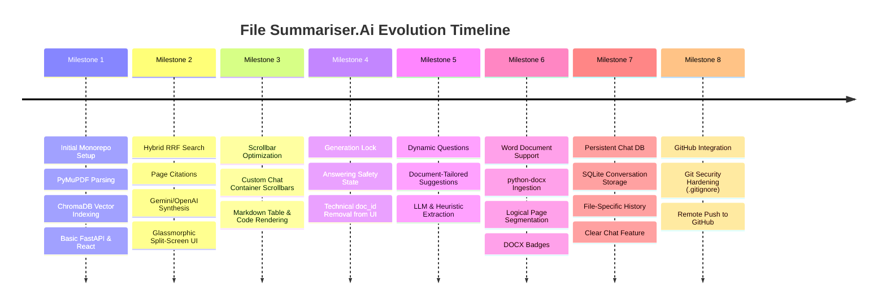

# Task-RAG / File Summariser.Ai: Complete Project Changelog & Evolution History

This document records the chronological development history, design decisions, feature additions, bug fixes, and architectural evolutions of **File Summariser.Ai** from project inception to the present.

---

## Evolution Timeline Summary

---

## Detailed Milestone-by-Milestone Changelog

### Milestone 1: Project Genesis & Foundational RAG Pipeline
- **Monorepo Initialization**:
  - Structured the project into `backend/` (FastAPI, Python 3.11+) and `frontend/` (React 18, Vite, Tailwind CSS).
  - Setup concurrent execution scripts in root `package.json`.
- **Document Extraction with PyMuPDF**:
  - Implemented high-speed C-based text extraction using `fitz.open()` with `sort=True` to preserve reading order in multi-column documents.
  - Implemented initial running header/footer noise stripping for documents $\ge 3$ pages.
- **Chunking Pipeline**:
  - Integrated `langchain-text-splitters` (`RecursiveCharacterTextSplitter`) with `chunk_size=1000` and `chunk_overlap=200` to prevent broken sentence boundaries.
  - Embedded `[Page X]` markers into every chunk for source tracing.
- **Local Vector Database**:
  - Integrated ChromaDB with local disk persistence (`./vector_db`), eliminating any external cloud vector database dependencies.
  - Utilized local CPU ONNX embedding model (`all-MiniLM-L6-v2`, 384 dimensions).

---

### Milestone 2: Hybrid RRF Retrieval & Split-Screen UI Modernization
- **Addressing Vector Blindness**:
  - Identified that pure cosine distance search missed exact numbers, statistical percentages (e.g. `99.85%`), and technical acronyms (e.g. `VQE`).
  - Developed custom **Hybrid Reciprocal Rank Fusion (RRF)** search combining dense embeddings with BM25 lexical term, exact phrase, and numerical scoring.
- **Dual-Provider LLM Integration**:
  - Implemented [`LLMService`](file:///e:/Task-RAG/backend/app/services/llm_service.py) supporting Google Gemini (`gemini-2.5-flash`), OpenAI (`gpt-4o-mini`), and an offline deterministic semantic synthesis fallback.
  - Enforced `temperature=0.0` with strict context-only system prompts to eliminate hallucinations.
- **Split-Screen Glassmorphic Interface**:
  - Developed a modern dark-mode interface with a dedicated document management sidebar on the left and an interactive chat window on the right.
  - Integrated Lucide React iconography, live ChromaDB indexing state indicators, and clickable page source badges (`Page X`).

---

### Milestone 3: Chat Container Ergonomics & Scrollbar Enhancements
- **Custom Scrollbar Styling**:
  - Added modern, slim, semi-transparent custom scrollbars (`custom-scrollbar`) in `frontend/src/index.css` and `frontend/src/App.css`.
  - Replaced standard browser scrollbars with custom hover-activated thumb styles matching the dark glassmorphic design system.
- **Viewport Layout Fixes**:
  - Configured `ChatWindow.jsx` and `FileUploader.jsx` with strict flex layout bounds (`flex-1 min-h-0 overflow-y-auto`) so the chat area and document lists scroll smoothly without pushing header or footer components offscreen.
  - Added smooth auto-scroll to bottom upon new message arrival.

---

### Milestone 4: Safety Concurrency Lock & Consumer-Ready Clean UI
- **Active Generation Lock**:
  - *Problem*: Users clicking other documents in the sidebar while an answer was actively generating caused race conditions and context mismatch errors.
  - *Solution*: Added `isAnswering` / `disabled` synchronization between `ChatWindow.jsx`, `App.jsx`, and `FileUploader.jsx`. While an answer is generating, file switching is visually locked with `cursor-not-allowed` and user inputs are disabled.
- **Technical ID Removal**:
  - Removed technical internal UUIDs (`doc_id: 79ae85fe-...`) from all user-facing views in the header and document cards, displaying only human-readable filenames, chunk counts, and page indicators.

---

### Milestone 5: Dynamic & Variable Suggested Questions Engine
- **From Static to Dynamic**:
  - *Problem*: Previously, the chat screen displayed the same static prompt questions ("What is the central topic...?") regardless of what file was uploaded.
  - *Solution*: Built [`generate_suggested_questions()`](file:///e:/Task-RAG/backend/app/services/llm_service.py) which analyzes document chunks to generate 3 to 4 domain-tailored, non-generic prompt questions.
- **Domain Intelligence**:
  - Resumes automatically receive questions about candidate skills, experience, and educational background.
  - Academic papers receive questions on OPTICS algorithms, methodology, and experimental results.
  - Project reports receive questions on supervisor, students, and architecture.
- **Metadata Caching**:
  - Stored suggested questions in `documents_registry.json`.
  - Added `GET /api/documents/{doc_id}/suggested-questions` endpoint for instantaneous retrieval on file selection.
  - Built skeleton loading states in the empty chat state.

---

### Milestone 6: Microsoft Word Document Support (`.docx`, `.doc`)
- **Expanding Beyond PDF & TXT**:
  - Installed and integrated `python-docx` for parsing Microsoft Word documents.
  - Extracted headings, paragraphs, and formatted multi-column tables with `|` row separators.
  - Added fallback binary stream decoding for legacy `.doc` files.
- **Virtual Page Segmentation**:
  - Continuous Word documents are automatically segmented into logical ~2,000-character pages, enabling citation badges (`Page X`) identical to multi-page PDFs.
- **UI Multi-Format Badges**:
  - Added dedicated styling in `FileUploader.jsx` and `DocumentSidebar.jsx`:
    - **PDF**: Crimson / Red badge (`bg-red-500/10 text-red-400`).
    - **DOCX / DOC**: Royal Blue / Indigo badge (`bg-blue-600/10 text-blue-300`).
    - **TXT**: Emerald Green badge (`bg-emerald-500/10 text-emerald-400`).
  - Updated dropzones and input file pickers with broad MIME types and extension filters (`.pdf, .txt, .docx, .doc`).

---

### Milestone 7: Persistent SQLite Chat Storage per Document
- **Conversation State Persistence**:
  - *Problem*: Refreshing the browser or switching between files previously erased the conversation thread.
  - *Solution*: Created [`ChatHistoryService`](file:///e:/Task-RAG/backend/app/services/chat_history_service.py) using SQLite (`vector_db/chat_history.db`).
- **Storage Lifecycle**:
  - User questions and assistant answers (including JSON-encoded page sources and formatted timestamps) are saved automatically on every turn.
  - Switching to any document immediately fetches and renders its prior conversation via `GET /api/documents/{doc_id}/chat`.
- **"Clear Chat" Action**:
  - Added a "Clear Chat" button in the chat header with a trash icon, allowing users to wipe history for the active document on demand via `DELETE /api/documents/{doc_id}/chat`.
  - Deleting a document also purges all related chat records automatically.

---

### Milestone 8: Git Security Hardening & GitHub Synchronization
- **Security Hardening**:
  - Built a comprehensive [`.gitignore`](file:///e:/Task-RAG/.gitignore) protecting API keys (`.env`), Python virtual environments (`backend/.venv`), Node modules (`frontend/node_modules`), build output (`dist/`), and vector database SQLite caches (`vector_db/`).
  - Added [`.env.example`](file:///e:/Task-RAG/.env.example) for secure cloning.
- **Version Control & GitHub Remote**:
  - Initialized Git repository on branch `main`.
  - Rebased and pushed all clean source code, services, frontend components, and comprehensive documentation to the remote repository:
    **[https://github.com/Nandu707/File-Summariser.Ai](https://github.com/Nandu707/File-Summariser.Ai)**.
