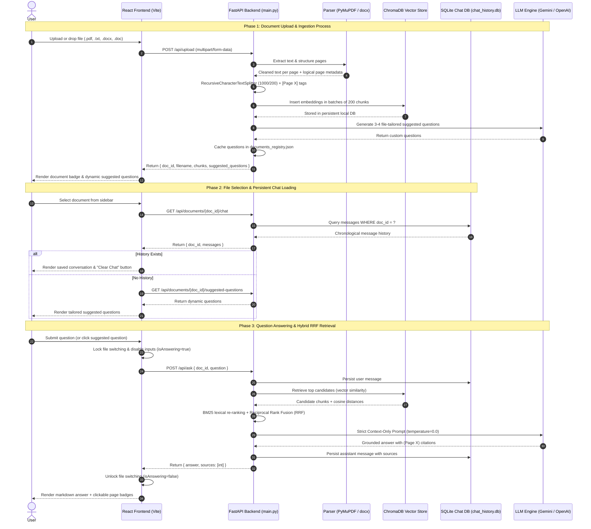
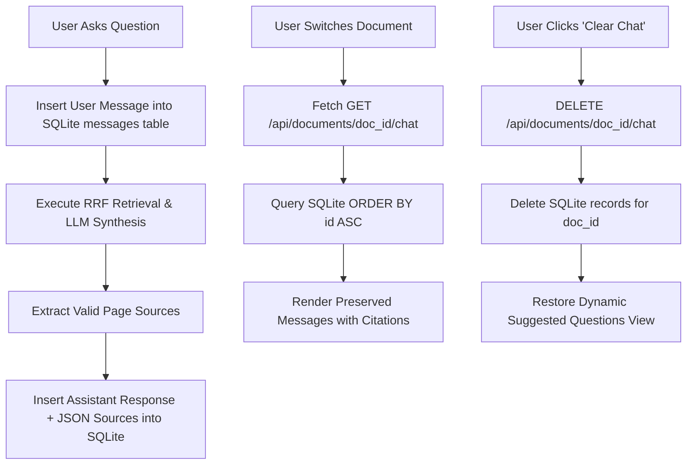
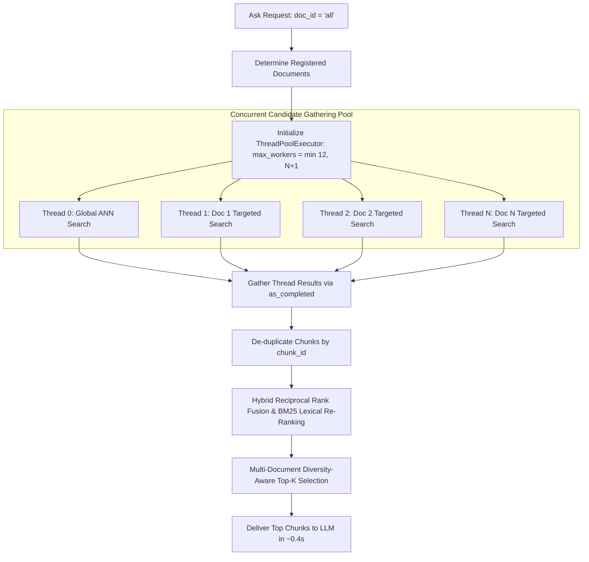
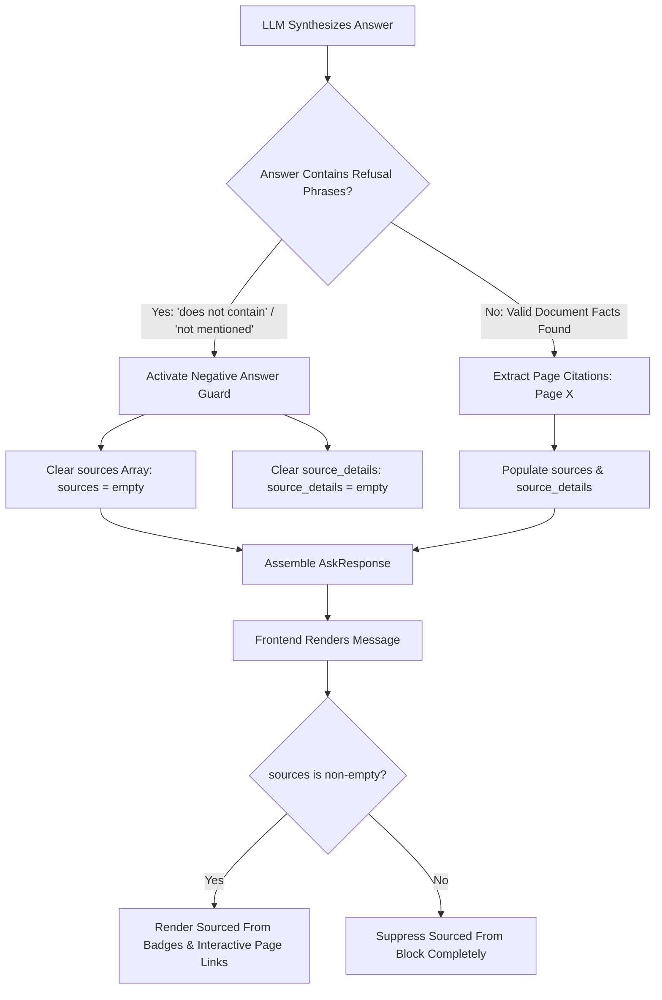
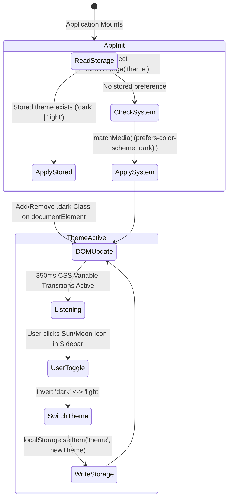
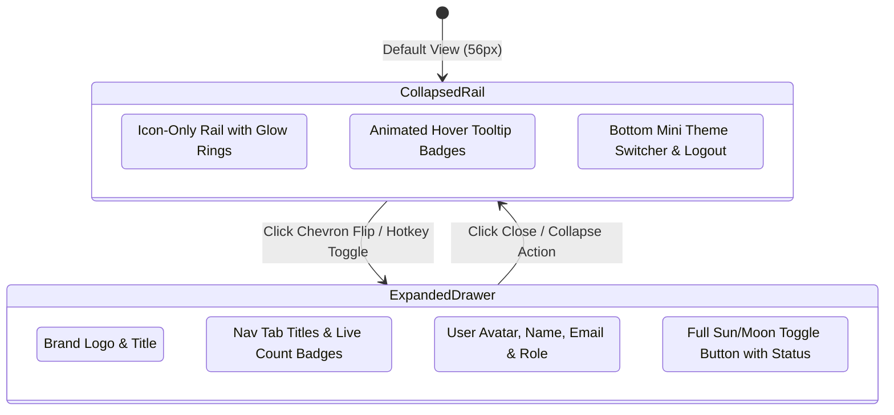

# Task-RAG / File Summariser.Ai: Complete System Processes & Workflow Guide

This document provides an end-to-end explanation of all core processes, data pipelines, algorithms, and operational lifecycles implemented in the **File Summariser.Ai** system.

---

## 1. High-Level Architecture & End-to-End Data Flow

The following sequence diagram outlines the complete interaction between the User, React Frontend, FastAPI Backend, PyMuPDF / python-docx, ChromaDB, SQLite Chat Store, and Generative LLM:



---

## 2. Document Ingestion Pipeline

When a file is uploaded to the backend via `POST /api/upload`, it is routed through specialized parsers according to its format:

```mermaid
graph TD
    A[Raw Upload: .pdf, .txt, .docx, .doc] --> B{File Extension}
    B -->|PDF File| C[PyMuPDF fitz.open]
    B -->|DOCX / Word| D[python-docx Parser]
    B -->|Legacy DOC| E[Stream Extraction Fallback]
    B -->|TXT / MD File| F[UTF-8 Text Decoder]
    
    C --> C1[Visual Layout Sorting: sort=True]
    C1 --> C2[Running Header/Footer Detection & Stripping]
    C2 --> G[Text Normalization & De-hyphenation]

    D --> D1[Paragraph & Heading Extraction]
    D1 --> D2[Table Cell & Row Formatting]
    D2 --> D3[Logical Page Slicing: ~2000 chars/page]
    D3 --> G

    E --> D3

    F --> F1[Heading Detection: Section X / Page Y]
    F1 --> F2[Virtual Page Segmentation: ~2500 chars]
    F2 --> G

    G --> H[RecursiveCharacterTextSplitter: 1000/200]
    H --> I[Prepend Page Marker: [Page X]]
    I --> J[ChromaDB Batch Ingestion: 200 chunks/batch]
    J --> K[Generate Dynamic Suggested Questions via LLM]
    K --> L[Update documents_registry.json]
```

### Format-Specific Parsing Rules:
1. **PDF (`PyMuPDF`)**:
   - `sort=True` analyzes geometric bounding boxes to extract multi-column layouts in visual reading order.
   - For documents with 3+ pages, running headers/footers occurring on $\ge 75\%$ of pages are stripped.
   - De-hyphenates words broken across lines (`superposi-\ntion` $\rightarrow$ `superposition`).
2. **Microsoft Word (`.docx`, `.doc`)**:
   - Uses `python-docx` to extract structured paragraphs, headings, and tabular data (cells formatted as `cell | cell`).
   - Slices continuous text flow into logical ~2,000 character pages to enable accurate page citation badges.
   - Fallback stream decoder prevents crashes on legacy binary `.doc` files.
3. **Plain Text (`.txt`, `.md`)**:
   - Detects explicit section breaks (`Section 1 (Page 1)`) or divides large files into ~2,500 character logical segments.

---

## 3. Dynamic Suggested Questions Generation Lifecycle

## 3. Dynamic Suggested Question Generation & Multi-Document Synthesis

Instead of static, generic questions, the system dynamically analyzes the document corpus to produce relevant prompts tailored to single documents or across all uploaded files:

```mermaid
graph TD
    A[Question Request: GET /api/documents/{doc_id}/suggested-questions] --> B{doc_id == 'all'?}
    
    B -->|Yes: Main Page| C[Inspect Full Registry: list all uploaded files]
    C --> D[Extract Representative Chunks from EACH Document]
    D --> E[Combine Excerpts: Document 1, 2, ... N]
    E --> F[Prompt LLM: Generate 4-6 specific questions spanning all files + cross-file comparison]
    F --> G[Cache in Memory Keyed by Uploaded File Set]
    G --> H[Return JSON Array to Frontend: Instant 0ms on revisit]

    B -->|No: Specific File| I{Cached in documents_registry.json?}
    I -->|Yes| J[Return Cached Questions Instantly]
    I -->|No| K[Sample Chunks from Selected Document]
    K --> L[LLM / Heuristic Single-Doc Analyzer]
    L --> M[Save to documents_registry.json under doc_id]
    M --> N[Return Questions Array to Frontend]
```

- **Single Document Tailored Output**:
  - *Resumes*: Questions regarding candidate experience, tech stack, certifications, and educational degrees.
  - *Academic / Research Papers*: Questions on algorithm complexity, methodology, benchmark results, and evaluation datasets.
  - *Project Reports*: Questions on problem statement, system architecture, team contributors, and conclusion.
- **Multi-Document Main Page Synthesis (`doc_id="all"`)**:
  - Automatically aggregates excerpts from every document currently in the registry (`project_report_full.pdf`, `ZOHO LONG PROGRAMMING QUESTIONS.docx`, `c questions.docx`, etc.).
  - Prompts the LLM with combined multi-file context to generate questions that distinctly cover the different uploaded files as well as comparative questions connecting multiple files.
  - **Zero-Latency Invalidation**: The multi-document questions are cached in memory keyed by the set of active document IDs; whenever a file is uploaded or deleted, the cache automatically invalidates and refreshes.

---

## 4. Persistent Chat Storage Lifecycle (SQLite)

Every conversation is preserved per document in a local SQLite database (`vector_db/chat_history.db`):



### SQLite Schema (`messages`):
```sql
CREATE TABLE IF NOT EXISTS messages (
    id INTEGER PRIMARY KEY AUTOINCREMENT,
    doc_id TEXT NOT NULL,
    role TEXT NOT NULL,         -- 'user' | 'assistant'
    content TEXT NOT NULL,      -- Full message markdown text
    sources TEXT,               -- JSON list of page numbers, e.g. '[1, 3]'
    timestamp TEXT NOT NULL,    -- Human-readable formatted time, e.g. '10:45 AM'
    is_error INTEGER DEFAULT 0  -- Boolean flag for failed turns
);
CREATE INDEX IF NOT EXISTS idx_messages_doc_id ON messages (doc_id);
```

---

## 5. Active Answer Generation Lock & Safety Concurrency

To prevent race conditions, context mismatches, or corrupted embeddings when interacting with multiple documents:

1. **Generation Lock Trigger**:
   - When a user submits a question, `onLoadingChange(true)` signals the parent `App.jsx`.
   - `isAnswering` state is set to `true`.
2. **UI Safety Constraints**:
   - Document switching in the sidebar is locked (`disabled=true`, pointer events disabled, cursor set to `not-allowed`).
   - Chat input textarea and send button are disabled with an animated spinner (`Loader2`).
   - Prevents switching to Document B while Document A is streaming an answer.
3. **Automatic Release**:
   - Once the response arrives or an error is caught in `finally { setLoading(false); onLoadingChange(false); }`, the interface unlocks smoothly.

---

## 6. High-Speed Parallel Multi-Document Candidate Retrieval

When querying across all documents (`doc_id="all"`), sequential queries across multiple files would introduce compounding latency (7–8 seconds). The system executes concurrent parallel vector searches:



- **Thread Pool Sizing**: Scaled dynamically as `min(12, len(registered_docs) + 1)`, ensuring rapid execution without exhausting CPU cores.
- **Fair Allocation**: Guarantees that smaller or newly uploaded documents are not starved by massive pre-existing documents.

---

## 7. Intelligent Citation Suppression & Grounding Verification

To maintain factual integrity and avoid confusing users with phantom source badges on out-of-scope questions:



- **Prompt Constraint**: System prompts strictly instruct the LLM: *"If the provided excerpts do not contain sufficient information to answer the question, state: 'The provided documents do not contain information to answer this question.' and do NOT cite any pages."*
- **Response Cleaner**: In `backend/pages/chat.py`, any refusal phrasing triggers immediate suppression of source lists, guaranteeing zero phantom citations.

---

## 8. Global Light & Dark Theme State Engine



- **CSS Transition Smoothness**: Applied across all structural containers with `transition: background-color 0.35s ease, border-color 0.35s ease`.
- **Contrast & Precision Guards**: Styled with explicit Tailwind `dark:` tokens and `:not([class*="dark:"])` safety wrappers in `index.css`.

---

## 9. Collapsible Dual-Mode Navigation Rail (ChatGPT Layout)



