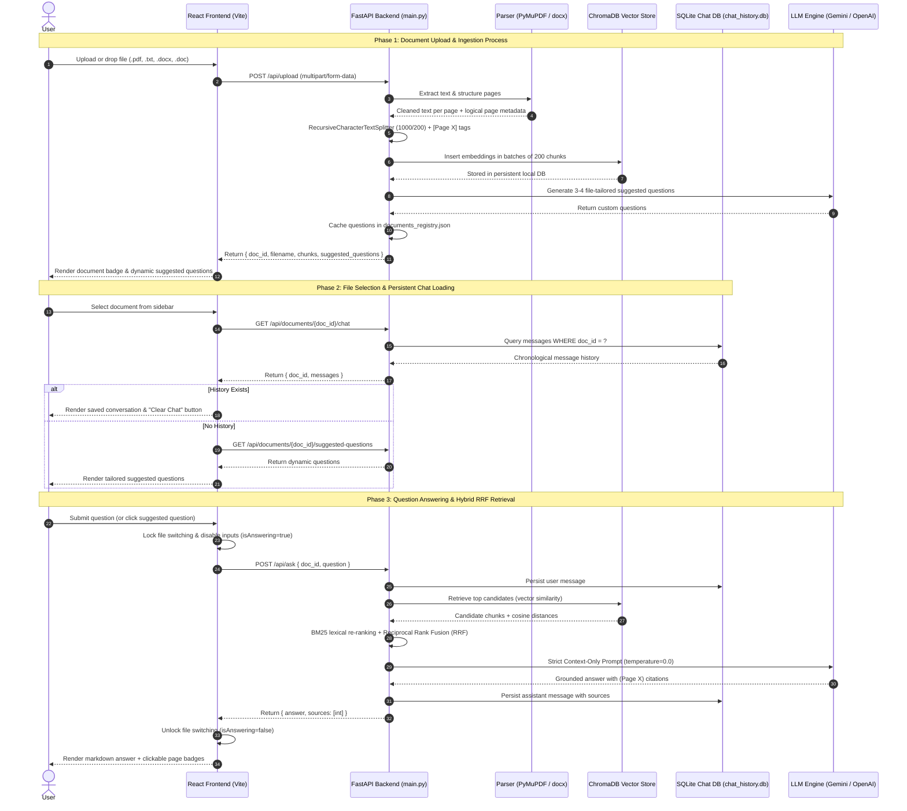
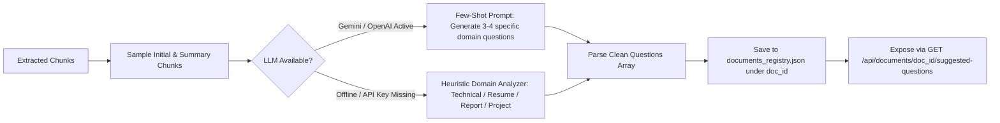
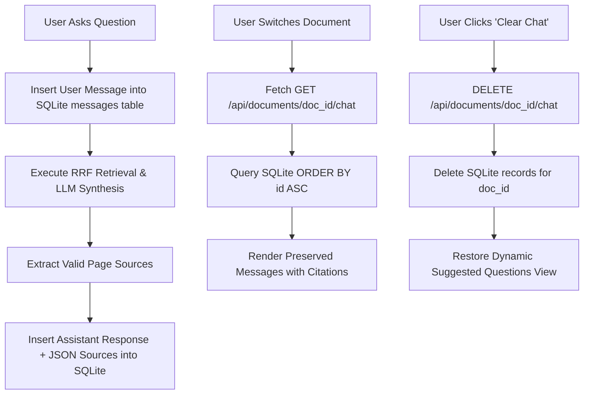

# Task-RAG / File Summariser.Ai: Complete System Processes & Workflow Guide

This document provides an end-to-end explanation of all core processes, data pipelines, algorithms, and operational lifecycles implemented in the **File Summariser.Ai** system.

---

## 1. High-Level Architecture & End-to-End Data Flow

The following sequence diagram outlines the complete interaction between the User, React Frontend, FastAPI Backend, PyMuPDF / python-docx, ChromaDB, SQLite Chat Store, and Generative LLM:



---

## 2. Document Ingestion Pipeline

When a file is uploaded to the backend via `POST /api/upload`, it is routed through specialized parsers according to its format:

```mermaid
graph TD
    A[Raw Upload: .pdf, .txt, .docx, .doc] --> B{File Extension}
    B -->|PDF File| C[PyMuPDF fitz.open]
    B -->|DOCX / Word| D[python-docx Parser]
    B -->|Legacy DOC| E[Stream Extraction Fallback]
    B -->|TXT / MD File| F[UTF-8 Text Decoder]
    
    C --> C1[Visual Layout Sorting: sort=True]
    C1 --> C2[Running Header/Footer Detection & Stripping]
    C2 --> G[Text Normalization & De-hyphenation]

    D --> D1[Paragraph & Heading Extraction]
    D1 --> D2[Table Cell & Row Formatting]
    D2 --> D3[Logical Page Slicing: ~2000 chars/page]
    D3 --> G

    E --> D3

    F --> F1[Heading Detection: Section X / Page Y]
    F1 --> F2[Virtual Page Segmentation: ~2500 chars]
    F2 --> G

    G --> H[RecursiveCharacterTextSplitter: 1000/200]
    H --> I[Prepend Page Marker: [Page X]]
    I --> J[ChromaDB Batch Ingestion: 200 chunks/batch]
    J --> K[Generate Dynamic Suggested Questions via LLM]
    K --> L[Update documents_registry.json]
```

### Format-Specific Parsing Rules:
1. **PDF (`PyMuPDF`)**:
   - `sort=True` analyzes geometric bounding boxes to extract multi-column layouts in visual reading order.
   - For documents with 3+ pages, running headers/footers occurring on $\ge 75\%$ of pages are stripped.
   - De-hyphenates words broken across lines (`superposi-\ntion` $\rightarrow$ `superposition`).
2. **Microsoft Word (`.docx`, `.doc`)**:
   - Uses `python-docx` to extract structured paragraphs, headings, and tabular data (cells formatted as `cell | cell`).
   - Slices continuous text flow into logical ~2,000 character pages to enable accurate page citation badges.
   - Fallback stream decoder prevents crashes on legacy binary `.doc` files.
3. **Plain Text (`.txt`, `.md`)**:
   - Detects explicit section breaks (`Section 1 (Page 1)`) or divides large files into ~2,500 character logical segments.

---

## 3. Dynamic Suggested Questions Generation Lifecycle

Instead of static, generic questions, the system dynamically analyzes the document to produce relevant prompts:



- **Domain-Tailored Output Examples**:
  - *Resumes*: Questions regarding candidate experience, tech stack, certifications, and educational degrees.
  - *Academic / Research Papers*: Questions on algorithm complexity, methodology, benchmark results, and evaluation datasets.
  - *Project Reports*: Questions on problem statement, system architecture, team contributors, and conclusion.
- **Caching**: Generated questions are stored in `documents_registry.json` so subsequent file selections retrieve suggestions instantly without re-querying the LLM.

---

## 4. Persistent Chat Storage Lifecycle (SQLite)

Every conversation is preserved per document in a local SQLite database (`vector_db/chat_history.db`):



### SQLite Schema (`messages`):
```sql
CREATE TABLE IF NOT EXISTS messages (
    id INTEGER PRIMARY KEY AUTOINCREMENT,
    doc_id TEXT NOT NULL,
    role TEXT NOT NULL,         -- 'user' | 'assistant'
    content TEXT NOT NULL,      -- Full message markdown text
    sources TEXT,               -- JSON list of page numbers, e.g. '[1, 3]'
    timestamp TEXT NOT NULL,    -- Human-readable formatted time, e.g. '10:45 AM'
    is_error INTEGER DEFAULT 0  -- Boolean flag for failed turns
);
CREATE INDEX IF NOT EXISTS idx_messages_doc_id ON messages (doc_id);
```

---

## 5. Active Answer Generation Lock & Safety Concurrency

To prevent race conditions, context mismatches, or corrupted embeddings when interacting with multiple documents:

1. **Generation Lock Trigger**:
   - When a user submits a question, `onLoadingChange(true)` signals the parent `App.jsx`.
   - `isAnswering` state is set to `true`.
2. **UI Safety Constraints**:
   - Document switching in the sidebar is locked (`disabled=true`, pointer events disabled, cursor set to `not-allowed`).
   - Chat input textarea and send button are disabled with an animated spinner (`Loader2`).
   - Prevents switching to Document B while Document A is streaming an answer.
3. **Automatic Release**:
   - Once the response arrives or an error is caught in `finally { setLoading(false); onLoadingChange(false); }`, the interface unlocks smoothly.
