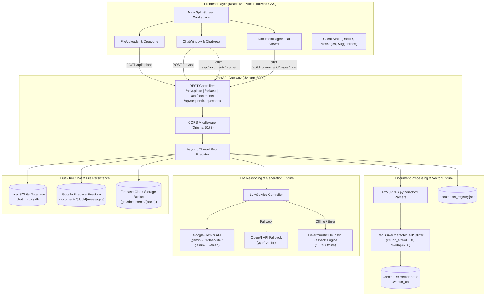
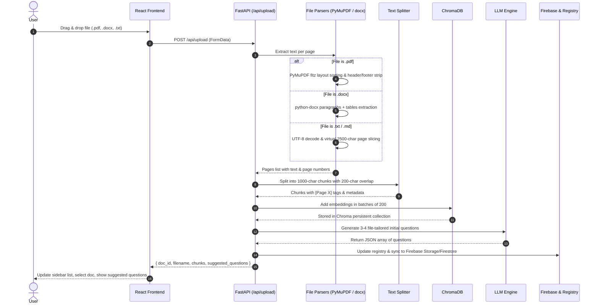
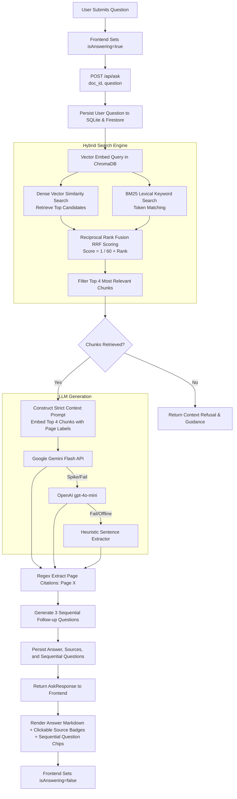
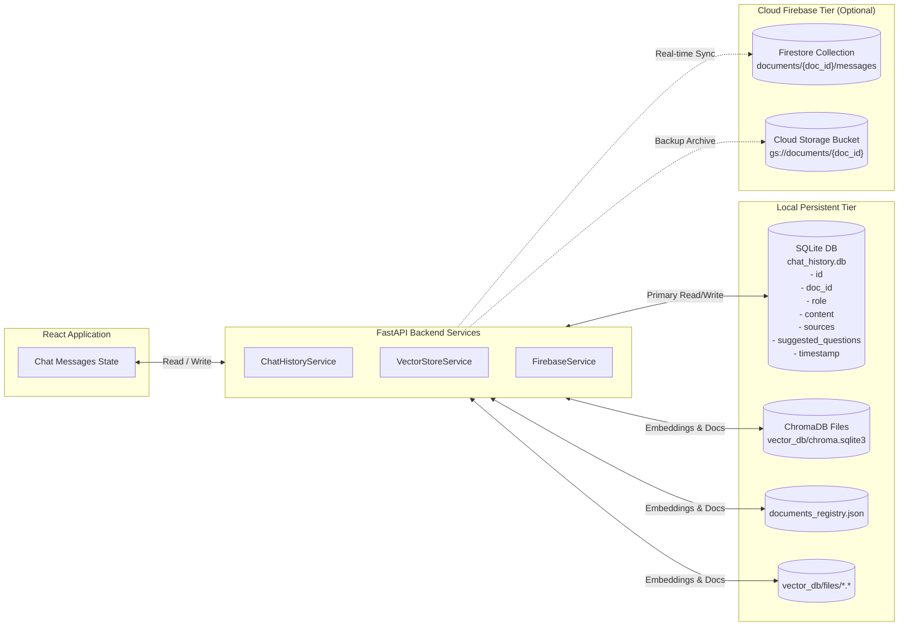
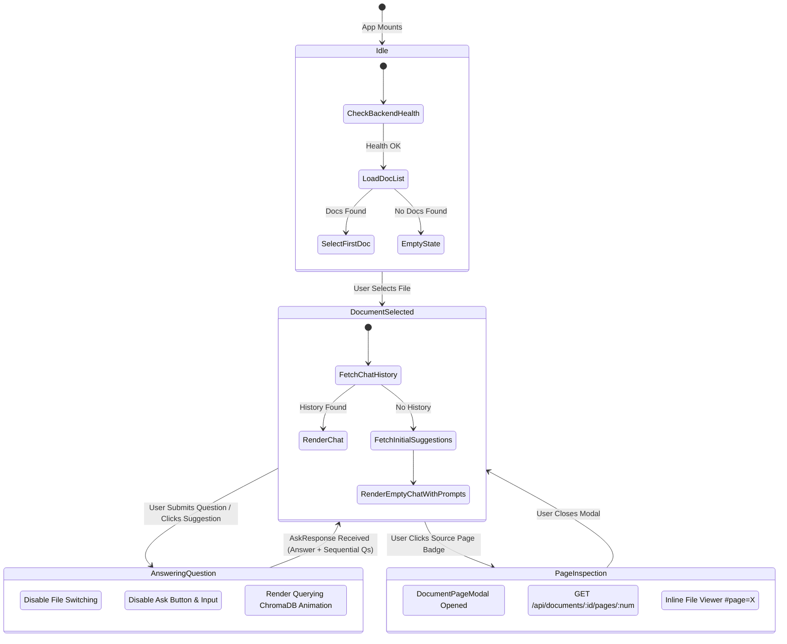
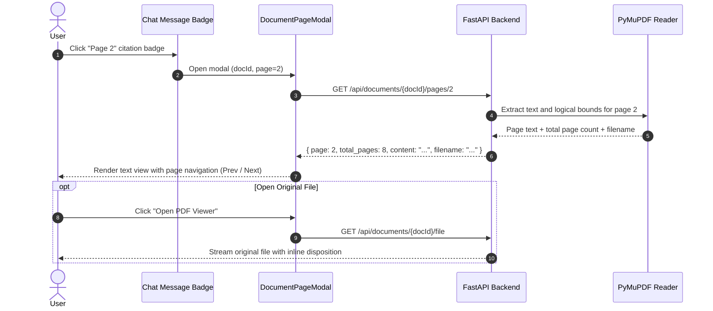

# File Summariser.Ai — Comprehensive Visual Process Guide

This document provides visual diagrams and architectural flowcharts for all end-to-end processes operating inside the **File Summariser.Ai** RAG platform.

---

## 1. High-Level System Architecture & Component Topology

---

## 2. Document Upload & Ingestion Pipeline

When a user uploads a document, the backend parses text, constructs page-aware chunk metadata, embeds chunks in ChromaDB, and pre-generates document suggestions.

---

## 3. Hybrid RRF Retrieval & Question-Answering Pipeline

The system retrieves the top semantic chunks using ChromaDB vector search and blends them with BM25 lexical ranking before passing them to the LLM with a strict context-only prompt.

---

## 4. Sequential Question Suggestion Flow (Follow-Up Generator)

After answering a question, the LLM generates 3 sequential follow-up questions relevant to both the document and the preceding Q&A exchange.

```mermaid
sequenceDiagram
    autonumber
    participant UI as Chat Window
    participant API as Backend (/api/ask)
    participant Store as Vector Store & Registry
    participant LLM as LLMService
    participant DB as SQLite & Firebase

    UI->>API: User asks: "What AWS services were used?"
    API->>Store: Retrieve chunks + doc metadata
    API->>LLM: generate_answer(question, chunks)
    LLM-->>API: Returns answer with page citations
    
    Note over API, LLM: Sequential Question Suggestion Phase
    API->>LLM: generate_sequential_questions(filename, question, answer, chunks)
    
    rect rgb(20, 30, 50)
        Note over LLM: LLM analyzes:<br/>1. Document subject & excerpts<br/>2. Previous question<br/>3. Generated answer facts & entities
        LLM->>LLM: Formulate 3 progressive logical follow-ups (JSON array)
    end
    
    alt LLM API Available
        LLM-->>API: ["How was Lambda connected to S3?", "What IAM policies were used?", "What deployment pipeline was configured?"]
    else API Timeout / Offline
        LLM->>LLM: _generate_heuristic_sequential_questions (entity keyword extractor)
        LLM-->>API: 3 entity-grounded fallback questions
    end

    API->>DB: Save assistant message + sources + suggested_questions
    API-->>UI: AskResponse { answer, sources, suggested_questions }
    
    UI-->>UI: Display Answer Card
    UI-->>UI: Render "Suggested Follow-up Questions" interactive cards
    UI-->>UI: Update "Next:" quick-action chips above input bar
    
    Note over UI: User clicks a follow-up chip -> Instant next question!
```

---

## 5. Dual-Tier Storage & Persistence Lifecycle

Conversations and indexed files are persisted locally in SQLite and synchronized with Firebase Firestore and Firebase Storage.

---

## 6. Frontend Split-Screen State Machine

---

## 7. In-App Document Page Viewer Modal Flow

When a user clicks on any source citation badge `(Page X)` in an assistant answer, the in-app modal opens directly to that page:

---

## Summary of Core API Contracts

| Endpoint | Method | Input Payload | Output Payload | Primary Engine |
| :--- | :--- | :--- | :--- | :--- |
| `/api/upload` | `POST` | `multipart/form-data (file)` | `{ doc_id, filename, chunks, suggested_questions }` | PyMuPDF / python-docx + ChromaDB + LLM |
| `/api/ask` | `POST` | `{ doc_id, question }` | `{ answer, sources: int[], suggested_questions: string[] }` | Hybrid RRF + LLM + Citations + Sequential Engine |
| `/api/documents/{id}/sequential-questions` | `POST` | `{ doc_id, question, answer? }` | `{ sequential_questions: string[] }` | LLM Sequential Follow-up Engine |
| `/api/documents/{id}/chat` | `GET` | `doc_id (path)` | `{ doc_id, messages: Message[] }` | SQLite / Firestore Chat Persistence |
| `/api/documents/{id}/chat` | `DELETE`| `doc_id (path)` | `{ doc_id, status: "cleared" }` | SQLite / Firestore Chat Reset |
| `/api/documents/{id}/pages/{num}` | `GET` | `doc_id, num (path)` | `{ page, total_pages, content, filename }` | PyMuPDF Text Slicer |
| `/api/documents/{id}/file` | `GET` | `doc_id (path)` | File binary (`application/pdf`, etc.) | Direct FileResponse Stream with `#page=X` |
